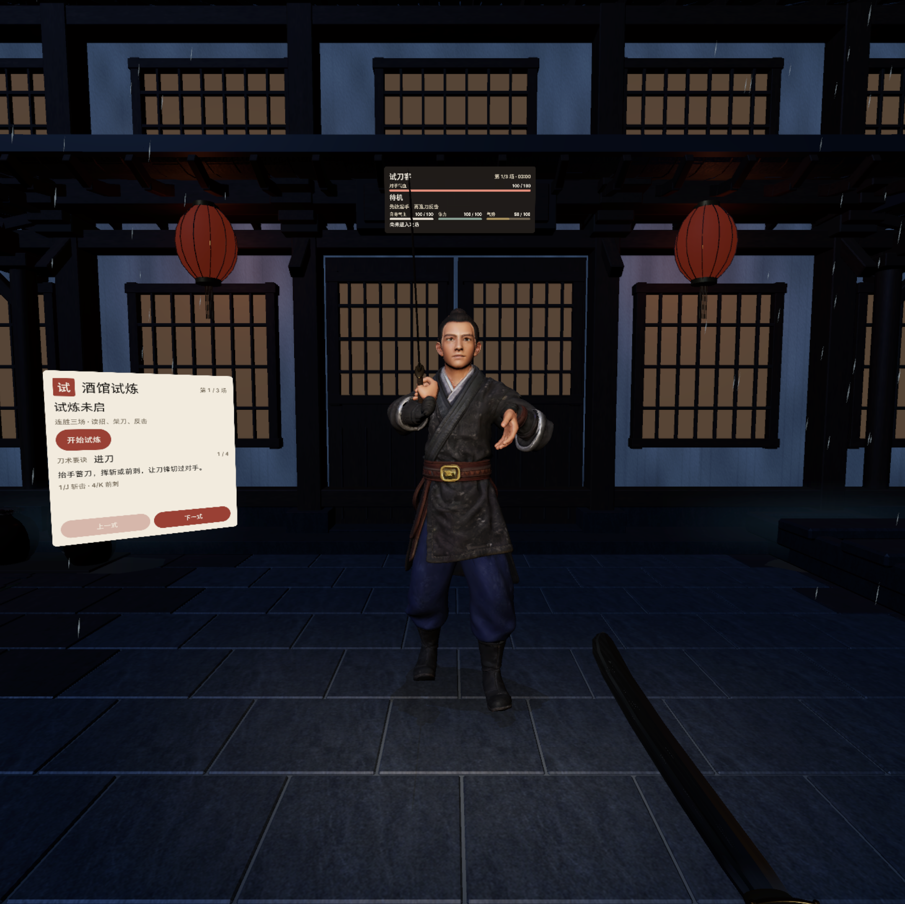

# 视觉对标与派修 bench

2026-11-11 · 12视觉审核。**当前基线已更新为 `integrated-2026-11-11.png`，APK `8d1e456e…`、源码 `6b407ac`、v4光；旧v3当前结论已替换。** 本路没有构建、发布、操作设备或替代Root做整局自玩。

## 当前版 · 6b407ac／v4原生图：三项判断

本版唯一当前入口为 `ArtSource/refinement/presentation/integrated-2026-11-11.png`，2160×2158，SHA `c23a267ed6b634a07d22b7193211f05d8420770b1f281830df4ea59216b33f6d`；已与同名JSON的capture SHA核对一致。APK为 `8d1e456e027c9ac14243e65db9171f5998909dd80400189f0451f0e1d99a6ede`，Root给定源码commit `6b407acc4507812b99d1315e58c8a2c588719fd0`，收据记录261项／0失败，本路未重跑。资源记录10clip、新刀、v4光、新庭院、雨、纸墨UI；新头未发布。相机距离没有标定，以下只按当前正常整幅取景审核。

| 项 | 本轮可见判断 | 下一步／责任路与收件条件 |
| --- | --- | --- |
| 1 · 已接受的明显进步 | **v4人物可读性显著提升，撤下v3“主体太暗”的当前返修结论。** 脸、双手、交领、袖口、腰带和腿部现在能分层阅读，脚下也有亮度过渡，教学完整，当前脸刀已分开。主体不再是一团暗形 | **07本轮收益接受。** 保留当前主体阅读基线，不因旧v3意见继续通体加曝光。旧头仍是旧头，不把本图记为新头脸提升；Root给出新头组合图后再审其骨相／发束和当前光色关系 |
| 2 · 下一视觉优先 | **环境材质与灯光联系仍落后于人物。** 重复窗纸仍是近乎均匀的褐色填块，大黑梁缺少边缘／木构层次；灯笼与相邻建筑暖光的联系较弱。人物变清楚后，背景平面感更明显 | **06主修、07配合，当前只交建议不动资产。** 优先已有窗纸局部透光／使用差异、顺构件木纹／搭接层次，再核灯笼光池与实际灯位的联系。下一同机位原生图要读出纸／木／墙／灯的区别和檐下纵深，不靠再堆窗格，也不让窗口重新压过主体 |
| 3 · 新刀暂不判材质失败 | **本图只能确认刀在当前角度呈细暗线，不能据此否定新dao。** 对手刀接近刃向镜头，前景刀以暗侧／窄角呈现，缺少可供审核的钢面面积。不能把旧版“新刀未集成／材质失败”沿用到本版 | **02＋07，Root统一取图。** 后续保持相同灯光与正常握持，转腕露出三分之四钢面，再判断刃口、宽钢面梯度、刀背暗面及反射变化；不能只靠KTX加载或metallic参数通过。没有这个角度之前，本项状态为“证据不足”，不是材质返修失败 |

这三项取代旧v3当前结论；教学和已解决石路不再派修。当前不改运行代码、模型、材质、灯值或正式发布资源，只更新本路审核文件。没有用离线图／SDK加载代替端内判断。

**阶段边界**：三敌预载OOM已由Root改为按轮单active，收据 `native_opponents_loaded=1`。本图只证明首轮可见启动，不证明整三轮切换／资源释放。`keyboard_combat_chain=false`、`controlled_hit=false`、`space_pro=false`；真实输入、命中／弹反、三方向正常循环、完整guard扫刀、音频触觉和Space Pro仍待Root专项证据。261测试通过不能替代这些运行事实。

完整来源和本轮三项决定见 [`ArtSource/bench/v4-native-review/review.json`](../ArtSource/bench/v4-native-review/review.json)。新头未发布；下一张头／刀正常角度的实际集成图再追，不在本轮提前拒绝候选。

## 上一版 · 8ebe75ac原生组合READY复审（历史）

来源：`artifacts/integrated-polish/ready-scene.png`，PNG SHA `c5a7a7d23c9f99b66fc418bffe01d8fcdc00a8e87a674d723905bbd0cb40186c`；与同目录 `verification.json`逐字节核对一致。APK为 `8ebe75ac05886a221bbc55c2c7f46fec491a0bdba94bf6b68ad2b933c9df23ab`，目标 `emulator-5554`，状态READY，Root记录10clip和250测试／0失败。本路未重跑测试。原图2160×2158；这是正常整幅取景，元数据没有相机距离，不能改称已标定0.8／1.5／3m。

**已在本图确认可见**：新庭院建筑立面与平整石路、雨条、纸墨UI、举刀guard姿态。已撤销旧版“环境／雨层／UI／guard尚未接入”的当前判断。22m庭院尺寸和10clip数量属于Root记录／资源身份，单张正前静帧不能证明全庭院转头连续性或三方向正常循环。人物新头仍未发布，不把此图当新头候选评审。

| 排序 | 当前画面问题与影响 | 负责人／下一步 | 同机位收件条件 |
| --- | --- | --- | --- |
| 1 · P1 | **主体、手和刀过暗。** 右侧人物脸／双手／衣物及刀面大块压入黑色；亮纸页、身后浅墙和窗格比对手更抢眼。夜景氛围已成立，但攻守主体不够可读 | 07已获Root派修；02配合核钢面。先让脸、两手、刀刃在原生灯光中有可读中间调与局部反射，保留夜景冷暖 | 相同READY姿态／HMD机位前后图，眼鼻、握持、护身手和刀面可分；墙窗不过曝，不能只整体抬曝光或用离线900lm等参数宣布修好 |
| 2 · P2 | **准备页底部裁切。** 纸页下沿已切到“刀术要诀”，说明内容落在面板外；这是实际原生容量问题，Web高度估算没有覆盖它 | 10已获Root派修，Root核Attachment。保开始与核心说明完整，通过内容压缩／分区和真实可用高度排版收口 | 原机位完整READY＋暂停／结算边界图，最后一行留有余量，按钮可见；不把FIGHTING紧凑板误改回大说明页 |
| 3 · P2 | **guard刀身经过脸部，并继续遮到状态牌资源区。** 同一条黑刀从胸前跨面部伸向上方，脸、刀、信息牌缺乏分离；主体提亮后仍有几何遮挡 | Root优先调整状态牌最终锚点避开真实刀路，10配合版式；09核canonical guard在正常玩家观察方向下的脸刀关系。姿态若改，必须保持防御意图并同步profile／代理，不能只偏移可见模型 | 先同机位READY让脸、刀与状态牌分离；随后用完整引刀／左右上／回守检查是否扫过读数。此条只证当前READY遮挡，未断言其它方向或全动作失败 |

只报告这三项作为本版最高优先，不再把旧版黑背景门墙或未发布铺地列为当前缺陷。原图的多项组合变更与旧酒馆不构成严格同机位A/B；本板完整保留本图、等比例缩放并加审核框，没有重绘场景。

**仍未验证**：`controlled_hit_capture=false`、`space_pro_verified=false`；命中／弹反、三方向循环、walk→guard过渡、音频／触觉同步、真机画质／性能／舒适性继续由Root取证。250项通过已取代先前共享timing失败的“当前回归状态”，旧失败记录只保留在历史段，不据本图反推已得到运行时接触证据。

证据与板SHA：[`ArtSource/bench/integrated-review/review.json`](../ArtSource/bench/integrated-review/review.json)。当前工作树HEAD仅是本路阅读时的节点，不据此推定上述APK的源码commit。

## 以下为首轮与第二阶段历史审核

首轮取证代码节点 `562449af40ee984ddd8ef61be5c339ac9bea2de5`，随后有本路只读离线透视渲染，以及08／09／10／11当时的新交付复核。下文“当前”“尚未发布”均指其段落对应的旧版本，最新结论以上节为准。

当前最影响观感的是**铺地和空间构图、原生光色、人物大结构、动作与接触呈现、UI层次**。已有铺地／门套候选具备肉眼可见收益，应优先组合；不能把毫米修形、微纹和导入结果累计成整体达标。

## 证据身份与审核边界

| ID | 实物 | 能证明什么 | 不能证明什么 |
| --- | --- | --- | --- |
| R01 | `artifacts/ui-input/current-scene.png` | 已有模拟器READY整人取景、人物／刀／铺地／准备面板的共同画面 | 缺相机距离与APK绑定元数据；不称为已标定1.5m，也不声称来自最新109项回归的APK |
| R02 | `ArtSource/refinement/presentation/combat-feedback-outcome.png` | 模拟器DEFEAT、青衫角色及结算UI；上方状态牌确实被画面顶缘裁切 | 其verification记录为旧节点 `c363f2e…`、APK `365e7749…`，且 `controlled_feedback_capture=false`；不能证明接触FX或最新交战UI |
| E01 | `ArtSource/refinement/environment/review/{before,after_v2}/` | 三组同机位、同灯光的真实GLB离线改进 | 不是PICO原生渲染、没有运行时人物，不能证明发布／IBL／碰撞／湿石端内效果 |
| A01 | `ArtSource/tripo-warrior/review/attack-bank-candidate/review/` | 三方向不同引刀和接触姿态、渲染manifest所绑定的旧候选轮廓 | `ortho_scale=3.5`是正交范围，绝不是3.5m透视距离；关键帧不证明完整动作或正常循环；13:15复核三角色GLB已更新，旧板不能作为新SHA批准依据 |
| C01 | `ArtSource/refinement/character/design/collar-refinement/stage4/retopo/renders_v3b/` | 同REST正面PBR局部对照，连续交领结构仍需修 | 胸部放大图不证明整人视距；候选自评 `blocked_visual_target`，不计通过 |
| V01 | `ArtSource/refinement/effects/contact-polish/review/contact_timeline.png` | 修正独立Alpha后的金属／弹反／湿布粒子时序 | 深色孤立背景不证明1.5m／3m下可辨、真实接触方向或运行时接线 |

图像SHA和尺寸见 [`ArtSource/bench/evidence-manifest.json`](../ArtSource/bench/evidence-manifest.json)。R01与R02角色、状态、取景不同，**不能组成严格前后A/B**。

本轮采用“现有端内缺口＋真实候选受控对照＋最终端内补证”路线。单做参考拼贴难以派修；只审棚拍会漏掉空间和接线；直接争抢设备又会干扰Root的统一验证。候选、代码、模拟器与Space Pro四种状态分别记录。

## 给Root的五项最高影响派修

| 优先级／负责人 | 具体可见问题与证据 | 应采取的修法 | 收件画面与通过条件 |
| --- | --- | --- | --- |
| P1 · 06；Root发布 | R01／R02前景的厚石板、大黑沟和重复缺口比人物更抢眼；屋檐外、左右为黑，整体像一面门墙。E01改善了石路，主构图仍未变化 | 先组合已有细缝铺地与分块门套；06继续侧街、檐下和小镇远景，做前／中／远三层，保留站立和战斗通道 | 同一机位原生前后图，石路不再像悬浮拼块；正前及左右转头时有连续可读空间。不能仅用更多道具填黑 |
| P1 · 07；02配合刀面 | R01／R02灯笼暗红，缺少墙／路面暖光池；脸、手、门楼主次弱，近处刀读成暗灰平面。旧近景PBR因子图变化不足以解决整体 | 明确冷环境、暖灯笼、脸与刃口、暗部轮廓、远景衰减；先让真实材质和原生照明有效，02核钢面／刀背／刃口分工 | 原角色、原庭院、原机位、相同曝光的neutral／目标光照；脸与来刀手可读，正常握刀角可见钢面反射变化。IBL加载状态与可见结果同时给出 |
| P1 · 05＋03 | R01／R02人物面部年轻平滑，眉弓／眼窝／发际和领襟靠大色块；C01外襟起伏不连续，花斑压过结构 | 05先做成熟骨相、眼睑、鼻唇和分层发束；03先连续领边、内外襟厚度与自然服装轮廓，再微纹／扣具 | 0.8m、1.5m固定透视三视角＋1.5m整人，原／候选同光；转头和抬臂仍保持形体。设计图、任务成功和局部棚拍均不能替代实物 |
| P1 · 09＋08；01／04提供动作与素材 | A01三方向准备已可辨，但棚拍不证明正常循环；V01普通金属与弹反起始外形接近，区别主要落在寿命／扩散。R02是败北静帧，不是强打击证明 | 09接同一profile驱动clip、刀路与接触代理；08做普通斩和弹反完整包络，让核心／方向碎屑／回收与卸力共同区别，04保留独立颗粒 | 人物同框、1.5m／3m完整引刀→接触→回守短片；禁用提示文字也能辨左右上、击中／格挡／弹反。连续补间、脚底、停顿后恢复和下一次出招一起看 |
| P2 · 10；Root容器接线 | R01／R02仍是黑圆角板、白字和彩色细条；R02上方状态牌被顶缘裁切。代码已有交战紧凑分支，不能把READY的大说明板误报为FIGHTING缺陷 | 在既有紧凑逻辑上建立纸墨／暗金／朱砂及数字主次；状态牌布局和世界深度配合，保证中文读数和标准交互语义 | 准备／交战／暂停／换轮／结算五状态，至少交战与结算端内完整同机位。正常视线可读、状态牌不被裁、不遮脸和刀路；字体远距阅读另由Root真机确认 |

### 现成可选的环境改进

这一项**离线接受，尚未端内通过**。左图为原资产，右图为真实候选；只做排版和等比例缩放，没有生成或重绘场景像素。

- 原酒馆 `ArtSource/tavern/tavern_slice.glb`：`af3adf8b15bb5aa6f34a9a5240e18bc2534bc977db4a05089a0c3a1ee1bbdc69`。
- 铺地 `ArtSource/refinement/environment/paving/paving_candidate.glb`：`bc9a7d0e4a5dc463ca2a73f4936f253e56efc6a87363c74c14b0a95f9e75d3fb`。
- 门套 `ArtSource/refinement/environment/entry/structure_entry_v2.glb`：`4f0b4ce49034ba938a574cddd377c3454e26c449d5eaefe404116641c8dfcfa7`。
- E01 player相机Stage位置 `(0,1.6,0)`、目标 `(0,1.45,-4)`、24mm；低角度和门槛另有受控配对，身份见 `review/render_evidence.json`。
- 接入依据：`environment_handoff.json`中 `Paving_Root/Paving`、`Structure_Root/Structure`，Stage平移 `(0,0,-4)`，forecourt相对Z为 `3.02`。Root替换现有对应部件，不叠放两层地面；端内核对Y=0、接缝和原生材质。

### 人物候选为什么未通过

C01整条交领折返仍缺乏稳定轮廓，新增局部面不能自动算服装质感升级。这个放大对照用于定位问题；最终仍需整人视距。05的生成记录属于制作进展，首轮审查时尚无可在这里宣布通过的新头脸三视角。

## 六组可执行对照

距离指HMD／评审透视相机到角色根的水平距离，坐标、FOV、角色身高、灯光和状态必须随图记录；全图等比例展示。0.8m的站立人物允许脚部出画，另补1.5m整人；不要缩放整人图伪装为不同距离。接触图同时记实际接触点距离，不能混淆这两个量。以下是收件协议，不是声称本轮已拍到这些新端内画面。

| 组 | 当前证据／缺口 | 同机位收件方法 | 重点检查与对应参考 |
| --- | --- | --- | --- |
| 站立近景 | R01／R02为不同人／状态；C01仅胸部；A01站姿为正交棚拍 | 0.8／1.5／3m，固定透视，同一刀客idle同一phase；头正／左右斜。原版与新头／衣物分别比较 | 骨相、眼睑、发际、领襟轮廓、皮肤／布／金属分工；《黑神话》取其结构和材质层次 |
| 引刀／接触／回守 | A01 phase为0.65／1.10s，contact为1.00s；不能当同刻前后 | 1.5m完整动作；3m轮廓检查；左右上每招准备、接触、随势、回守固定时点＋完整短片，按实际runtime phase标记 | 腰胯带肩、空手护身、刀刃朝向、脚底、连续回守；《影之刃零》《荣耀战魂》 |
| 弹反 | V01仅离线独立粒子，普通／弹反初始近似；没有本机位实际弹反 | 固定1.5／3m，同一次来刀分别格挡与弹反，记录接触前后0／约33／67／167／267ms及连续片段 | 刀刃偏转、敌人破势、核心与飞散方向、回收速度；《只狼》《鬼武者》。时间点是观察采样，不是照搬目标游戏时长 |
| 防御／闪避 | 旧guard与ground素材可看制作方向；没有端内三者同框对照 | 固定来刀／灯光，1.5m格挡支撑、3m闪避轮廓；拍进入动作和回守，不移动审核相机掩盖脚滑 | 防御有支撑、弹反有卸力、闪避保留敌人读感；近地尘不能变成持续雾遮住脚；《荣耀战魂》《只狼》 |
| 庭院探索 | E01同机位可靠；实际图仍黑背景门墙 | 沿原站位正前／左／右各一组，新旧同坐标，另从庭院入口回望；保留人物尺度锚点 | 建筑转折、门槛与台阶因果、路面细缝、排水与湿润分布、远景层次；《骑马与砍杀》《天国拯救》空间与生活痕迹，《黑神话》材质光色 |
| 交战UI | R01是READY，R02是DEFEAT；FIGHTING紧凑分支有代码但无本轮有效实图 | 同HMD位置、同1.5m对手，五状态各一张；加普通／要害／弹反的跳字／提示同框；0伤不画伤害 | 状态优先级、中文阅读、空间深度、脸刀遮挡、顶缘裁切；参考目标游戏的信息层次，最终服从VR原生控件与阅读 |

## 官方参考与如何使用

这些作品是质量维度参考。PC／主机宣传图不能据以承诺Space Pro性能、复制其镜头震动或直接移用角色、纹理、UI、原声。下面的“转译”是本项目的审核判断。

| 作品与官方来源 | 本项目转译／已核证范围 |
| --- | --- |
| [《黑神话：悟空》Game Science官网](https://gamesci.cn/wukong/) | 实际浏览HOME与MEDIA。首页面部宣传图显示眉眼体积、方向性毛发、皮肤与金属分工；本地 `ArtSource/bench/references/black-myth-official.png`为官网页面截图，**是宣传近景，不是VR视距性能基准**。以结构层次约束05／03／07，不能拿“加皱纹”代替骨相 |
| [《影之刃零》FIRST GAMEPLAY TRAILER](https://pbz.s-game.com/en-US/news/first-gameplay-trailer/)／[官方内嵌实机片](https://www.youtube.com/watch?v=cgBmIjaZraE) | 通过chrome-use读取官方原文，确认是2024-06-07实机预告及官方嵌入。对应攻守反应、方向连贯、身刀协同。当前没有逐帧计时数据，未编造参考游戏的停顿毫秒值 |
| [《只狼》官方Gallery与Enemy Featurettes](https://www.sekirothegame.com/) | 官方页面确有敌人演示和Gallery；用于弹反辨识／敌人读感的后续复核。直接图片加载本轮未成功，**没有落地有效《只狼》画面，也没有假称逐帧看过弹反** |
| [《鬼武者》Capcom官方入口](https://www.capcom-games.com/onimusha/ws/)／[Capcom作者的官方介绍](https://blog.playstation.com/2024/12/12/capcoms-onimusha-series-reawakens-with-onimusha-way-of-the-sword-in-2026/) | 对应近身攻守、肉身与金属接触的节奏。直达官网有访问限制，保留可验证的官方入口；本轮不提供伪造的片段时间码 |
| [《荣耀战魂》Ubisoft Art of Battle官方说明](https://www.ubisoft.com/en-us/game/for-honor/news-updates/2u0Ng5ufwteZGW2J9nIDq/how-to-play-controls-the-art-of-battle-for-honor-tips) | 官方明确介绍格挡／攻击、连段与破防。转译为LEFT／RIGHT／OVERHEAD首先靠身体和刀路辨识，方向提示辅助，不能让三招只换同一动画标签 |
| [《骑马与砍杀2》TaleWorlds官方Media](https://www.taleworlds.com/en/Games/Bannerlord/Media) | 官方目录包含Explore Vibrant Cities等场景项。转译为空间连续性、建筑尺度锚点与可行走关系；本轮网页图片受403限制，未把缩略搜索结果算已审实图 |
| [《天国拯救》Deep Silver官方页](https://www.deepsilver.com/games/kingdom-come-deliverance)／[系列II官方空间与战斗介绍](https://www.deepsilver.com/games/kingdom-come-deliverance-ii) | 系列官网旧入口现重定向II，明确区分版本。转译为酒馆／道路有使用痕迹、层级与生活逻辑，短Demo先建立可信的一段空间，不以“开放世界”扩大本轮范围 |

参考访问失败时只记录失败范围，并继续可做的本地审核。chrome-use已作为首选，部分官方页面的正文由网页搜索补核；没有下载目标游戏素材进运行包。

## 八条新线首轮收件状态

这是本轮一次冻结的实物审核，不是轮询等待清单。各线交新实物后按六组协议继续判定；未验证不等于不存在或失败。

| 线 | 已能审核／当前决定 | 下一项证据 |
| --- | --- | --- |
| 05头脸 | 生成记录不等于可装配头脸；新三视角未获视觉通过 | 原身体同灯0.8／1.5m三视角、颈部装配和正常idle |
| 06环境 | 旧E01铺地／门套离线接受；整体庭院返修 | 新纵深和雨后材质同机位，Root发布后端内复核 |
| 07光色 | 无同酒馆严格原生配光A/B；IBL互操作未验证 | 原生模块、灯位／资源身份、同机位neutral／目标图 |
| 08 VFX | 新增真实采样刀光几何的0.8／1.5／3m离线软件投影；热芯方向接受，1.5m／3m强度收益仍弱，强打击未通过 | 优先普通命中／弹反人物同框完整时序，再调刀光在真实灯光中的读感 |
| 09动作接线 | 真实clip／proxy统一profile与正常三方向代码已交；A01旧板不绑定当前SHA；本路D01表明idle外观未改善 | 实际AttackStarted三方向、guard／回守、接触同框；同新GLB／profile组合回归 |
| 10 UI | 五状态Web预览与真实Compose已交；纸墨分态、敌血主次和结算数字方向离线接受；端内仍未通过 | Root取FIGHTING／DEFEAT完整图，验裁切、字号与脸刀遮挡 |
| 11声音触觉 | 前后试听、CC0来源与代码已交，本路未试听／不给听感通过；11报告共享timing回归有8项失败待查 | Root核最新组合回归；音频／触觉专项与共享战斗失败分开，真机验证同步／触觉 |
| 12整体bench | 本报告＋三张实图排版已交；只修改审核范围 | 针对新交付按同一证据身份复审，每轮最高五项 |

## 不能用于通过的旧证据

- `ArtSource/refinement/lighting/review/actual-before.png`是系统卧室，`actual-after.png`才是酒馆；且 `capture.json`明确 `strict_same_camera_pose=false`。仅留作历史启动画面，不能证明配光A/B。
- `invalid_shared_alpha/`图已声明失效，不用于颗粒强度判断。V01有效时序板仍只是离线素材预演。
- A01板上的 `3.5`是正交取景范围；phase的0.65／1.10s与contact的1.00s不是同一时点。
- 共享目录会继续更新。13:15复核：A01 base旧板绑定 `d61af296…4263dd`，当前base已为 `0c2a4801aaa6b89866303a9c783b524a88b6440633f0c9348041a6239af7d48a`；indigo和veteran同样与旧phase板不匹配。旧轮廓观察仍有效，但新候选必须补自己的图，不能凭相同文件名继承视觉通过。
- 体量、面数、SHA、编译、单元测试、导入和API存在只负责身份与逻辑证明；视觉通过需要可见正常取景。静帧不能证明音频、触觉、掉帧、佩戴舒适性。

## 接入点与本轮验证

Root继续独占正式资源发布与Main／HomeStage最终接线。06候选目前没有进入正式 `models/tavern_slice.glb`；HomeStage仍加载原酒馆／forecourt／details。原生灯光为既有方向光和补光，新IBL／雨雾没有本轮有效端内证据。09／08交自己的模块和最小集成点，不能因源文件存在就标记画面已改善。

本轮实际验证：打开R01／R02、E01前后、A01、C01、V01；核对来源manifest与相机；检查正式资源／场景引用；为新板逐一核对输入SHA、全图比例和文字排版。**未运行构建／测试／设备；未验证最新版交战完整流程、1.5m／3m运行时对照、Space Pro性能／舒适性。**

## 第二阶段 · 正常透视尺度与新线复审

### D01 · 正式8clip与新10clip的idle基线

这是本路新制作的6张真实GLB离线图。固定100°透视、1.6m眼高、向下5°，到角色原点的水平距离分别0.8／1.5／3m；相机和白色棚灯一致，模型没有归一化或为装下画面而缩放。每格保留完整768×768渲染。

- 正式base：`53b80e71fbc986fc6021ac910a57fe11ba2d60d521ee371796ea1fb8b2d00641`。
- 当前候选base：`0c2a4801aaa6b89866303a9c783b524a88b6440633f0c9348041a6239af7d48a`。
- 两者均取 `idle` 1.0s，渲染前后输入SHA未变。结果没有可见站立形象升级，因此10clip候选的价值应在攻守动作与接线中评估；成熟头脸、服装、配光仍是独立工作。3m画面优先读轮廓、刀和大明暗，局部扣具／布纹不能代替它们。
- 脚部在0.8m近景出画属于固定透视结果。该100°是本次评审相机参数，**不是声称已测得Space Pro实际FOV**。
- 可复建源码：`ArtSource/bench/render_distance_review.py`；原始6图、相机、来源、帧SHA、idle像素比较在 `ArtSource/bench/distance-review/manifest.json`。使用已安装Blender 4.5.15 LTS，单进程、2线程、8 samples；源资产及其它制作目录未写入。

### 08 · 刀光热芯实物

检查 `ArtSource/refinement/effects/runtime-polish/trail-review/trail_compare_1.5m.png`、`trail_compare_3.0m.png`及 `review.json`。这是实际Desktop LEFT_SLASH输入导出的几何软件投影，HFOV90°，before／candidate同相机，已有65ms尾迹上增加12ms热芯。距离是到尾迹包围盒中心，不能和D01的角色根距离混用。

结论：**保留真实采样和窄热芯方向；整体强度待返修／端内补证。** 1.5m仅近端一小段亮起，3m只剩一点暖亮，无法据此宣布刀光／强打击显著升级。没有Bloom、曝光、SDK tone mapping和人物遮挡，因此既不把弱软件投影当最终端内失败，也不接受“已有热芯”作为通过。下一项优先做普通命中与弹反的完整接触包络，交同场景人物同框。

### 10 · 五状态UI实物

检查 `ArtSource/refinement/ui-design/ready-preview.png`、`fighting-preview.png`、`victory-preview.png`和 `validation.json`。这三张足以确认纸白／墨色分态、朱砂操作／方向、敌血主条和44sp结算数字的实际布局收益。**设计方向接受**，比仅换边框有更明确的信息层次。

仍需Root端内复核：左控制与上方状态牌是否完整入视、1.5m中文字形、背景混合、敌人脸刀遮挡。Web的浅灰背景、合成样本状态和 `isTrusted=false`组件事件不当作VR场景、真实三轮或手柄证据。本轮也没有拿Web预览去要求Root恢复400dp交战大板。

### 09／11 · 组合验收提醒

09已交真实三方向profile／clip／代理代码，当前来源SHA与D01一致，应由Root与正式10clip资产一起组合。11已交真实WAV、CC0来源及消费代码；11交接指出最新共享 `CombatFeedbackTimingTest` 有8项失败，不能沿用旧109项通过宣称当前共享树仍通过。这里只转述有出处的回归提醒，未定位为09或11的根因，也未越权修共享战斗逻辑。视觉最终取图要绑定实际通过的组合节点。
